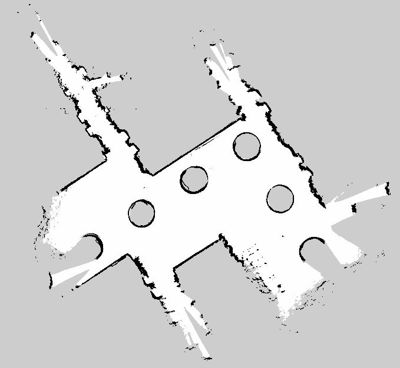
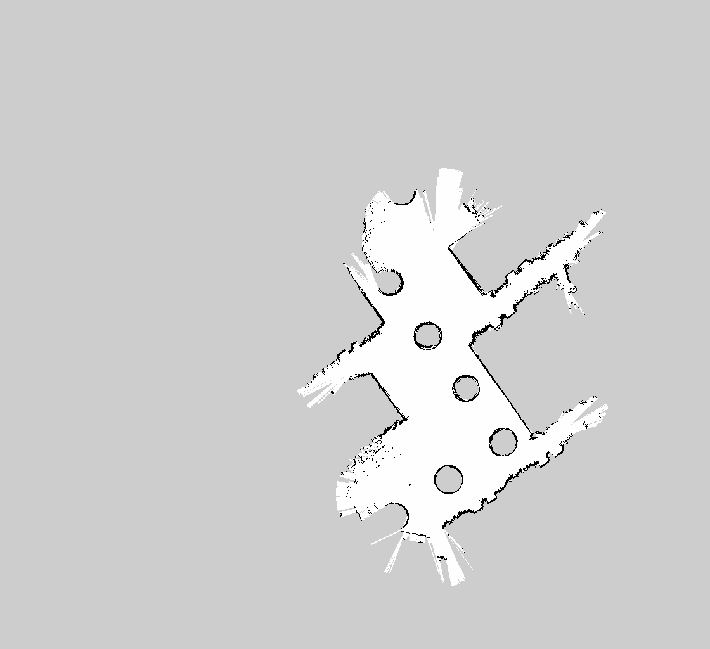
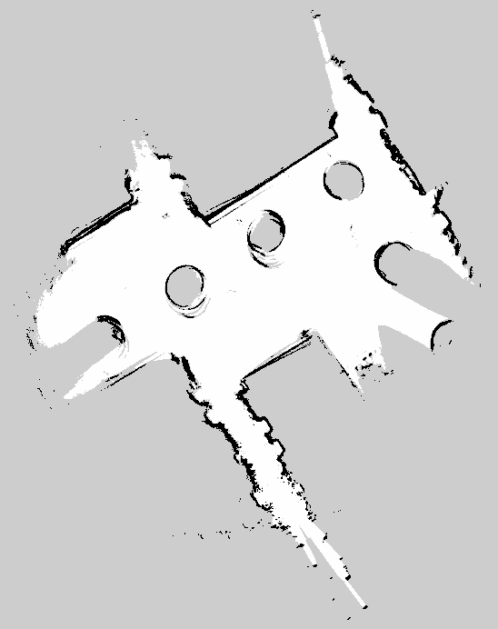
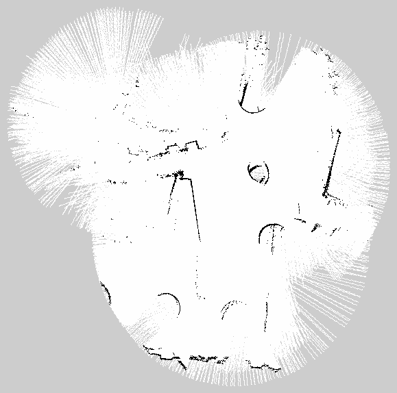
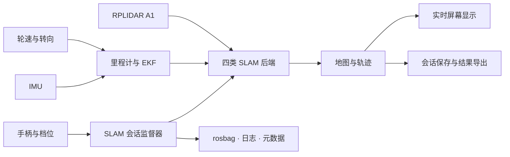

<div align="center">

# ROSMASTER R2 · LiDAR SLAM Lab

### 阿克曼移动机器人的多算法建图与实验研究

在真实机器人上接入 SLAM、记录实验、定位问题，并让每一项结论都能回到数据。


[](https://github.com/HuangChenhao/ROS_LiDAR_SLAM/releases/tag/v2.1.0-research)

**[实验与结论](docs/EXPERIMENTS.md) · [研究报告提纲](docs/REPORT_OUTLINE.md) · [机器人操作](docs/ROBOT_SETUP.md) · [复查实验](docs/REPRODUCIBILITY.md)**

**[版本更新](CHANGELOG.md) · [版本演进](docs/VERSION_HISTORY.md) · [问题与修复](docs/ISSUES_AND_FIXES.md) · [原始数据下载](docs/DATASET.md)**


**A real-robot SLAM testbed for system integration, mapping and evidence-based diagnosis.**

</div>

---

<table>
<tr>
<td align="center" width="25%"><h3>4</h3>激光 SLAM 后端</td>
<td align="center" width="25%"><h3>9</h3>保留的 ROS2 会话</td>
<td align="center" width="25%"><h3>33.7 min</h3>非空 bag 累计时段</td>
<td align="center" width="25%"><h3>14,882</h3>已记录激光帧</td>
</tr>
</table>

统计来自 2026-07-22、07-23 的本地原始数据核对：8 个 bag 非空，包含行驶、故障及静止验证时段。完整数据口径见[实验盘点](docs/EXPERIMENTS.md)。

**研究快照：[v2.1.0-research](https://github.com/HuangChenhao/ROS_LiDAR_SLAM/releases/tag/v2.1.0-research)。** Release 提供三份原始归档、SHA-256 和恢复入口；代码继承 v2.0.0 的运行实现，本次补齐数据与版本/问题档案，未新增实车精度结论。

## 研究目标

让 ROSMASTER R2 在 Raspberry Pi 5 上完成激光建图，并建立一套可以切换算法、保存现场、复查问题的实验流程。

本项目围绕三个问题展开：**建图系统如何稳定运行？地图异常来自哪里？怎样让算法比较有可靠依据？** 工作涵盖 ROS1 到 ROS2 的迁移、手柄与档位控制、里程计和 IMU 接口、多算法 SLAM、会话记录，以及地图和轨迹的显示。

## 实验结果画廊

<table>
<tr>
<td align="center" width="50%">
<b>Cartographer · 低速行驶会话</b><br><br>
<br>
559.1 s · 4,071 帧扫描 · 679 × 626 栅格
</td>
<td align="center" width="50%">
<b>GMapping · 行驶建图</b><br><br>
<br>
624.4 s · 4,607 帧扫描 · 1120 × 1024 栅格
</td>
</tr>
<tr>
<td align="center">
<b>Cartographer · 较高速度会话</b><br><br>
<br>
291.6 s · 2,150 帧扫描 · 548 × 692 栅格
</td>
<td align="center">
<b>RTAB-Map 2D · 问题诊断样例</b><br><br>
<br>
264.0 s · 1,942 帧扫描 · 存在优化器告警
</td>
</tr>
</table>

地图分辨率约为 0.05 m/格。不同会话的路线、时长和速度不同，这组图展示各次输出与问题现象；算法精度排名需要统一条件的重复实验。

**继续查看：[全部会话地图与轨迹](scan_archives/20260722_latest/scan_contact_sheet.png) · [修复后的静止验证](scan_archives/20260723_validation/scan_contact_sheet.png) · [逐次实验总表](reports/session_summary_20261117.csv)**

## 系统架构



| 实现部分 | 项目中的工作 | 对应代码 |
|---|---|---|
| 底盘与传感器 | 阿克曼里程计、IMU/EKF、启动检查及设备管理 | [里程计](patches/rosmaster_odom.py) · [EKF](patches/ekf_r2.yaml) · [健康检查](patches/robot_healthcheck.py) |
| 会话管理 | 按算法和档位建立会话、录制数据、保存地图、监测后端与磁盘状态 | [SLAM 监督器](patches/slam_supervisor.py) |
| 人机交互 | 遥控、档位、LED 算法提示、地图缩放与轨迹显示 | [手柄补丁](patches/yahboom_joy_R2_patched.py) · [地图显示](patches/map_kiosk.py) |
| 启动与运行 | Docker、ROS2 节点与 systemd 入口 | [启动脚本](patches/ros2_bringup.sh) · [启动服务](systemd/rosmaster-ros2.service) |

## 四种算法的验证状态

| 算法 | 保留的实验 | 当前证据支持的结论 |
|---|---|---|
| **GMapping** | 1 次 ROS2 行驶会话；早期 ROS1 地图导出 | 已生成地图；ROS2 轨迹为空、结束元数据不完整 |
| **Cartographer** | 2 次行驶 + 1 次静止验证 | 已保存地图、约束修正记录与优化轨迹输出 |
| **SLAM Toolbox** | 1 次故障 + 1 次静止验证 | 定位到后端致命异常；后续静止验证未复现同类异常 |
| **RTAB-Map 2D** | 1 次启动中止、1 次行驶 + 1 次静止验证 | 已保存地图和数据库；定位到优化器告警，动态闭环仍需验证 |

三次修复验证均为静止测试；`gear2` 是档位标签，不能据此称为二档行驶精度测试。RGB-D + LiDAR 已有[研究配置](research/rtabmap_rgbd_r2.yaml)，本次数据中没有对应融合会话。

## 从实验中定位的问题

| 观察到的现象 | 核对到的证据 | 项目中的处理与验证 |
|---|---|---|
| 有地图文件，却没有正常完成建图 | SLAM Toolbox 的 `complete` 标签与 probability-search 致命日志矛盾 | 联合检查后端、轨迹与地图；后续静止会话保存 561 帧扫描且未复现该异常 |
| 日志出现“闭环”，却无法证明成功闭环 | 旧计数匹配到了“词袋闭环检测被禁用”的提示 | 回查日志原文与数据库约束，不把关键词数量当作成功次数 |
| 地图修正了，显示的红线仍然错位 | 旧轨迹来自在线采样，未随图优化重写 | 导出与显示接入优化轨迹；Cartographer 静止验证保留 147 个优化轨迹点 |
| 数据库有数据，标准回放信息却不完整 | GMapping bag YAML 为空，轨迹为空，会话元数据含 NUL | 保留异常现场，通过 SQLite 只读核对；恢复回放时在副本上重建元数据 |

这部分是项目研究的核心：把“地图看起来异常”转化为可查证的问题，再分别验证系统、显示与后端行为。[查看完整证据与结论边界 →](docs/EXPERIMENTS.md)

## 研究进展

| 阶段 | 完成的工作 | 记录 |
|---|---|---|
| 早期 ROS1 建图 | 跑通建图、定时保存、二维占据地图导出 | [历史产物盘点](docs/EXPERIMENTS.md#4-早期-ros1-工作) |
| 2026-07-15 | 手柄、LED、档位联动和实时地图显示 | [研发日志](logs/2026-07-15b_档位联动建图与屏幕实时显示.md) |
| 2026-07-17 | Cartographer 接入、地图渲染与离线重建排查 | [研发日志](logs/2026-07-17_cartographer与问题排查.md) |
| 2026-07-22 | 四类激光 SLAM 的运行与问题记录 | [实验总表](reports/session_summary_20261117.csv) |
| 2026-07-23 | 三种后端的修复后静止验证 | [验证记录](docs/EXPERIMENTS.md#3-2026-07-23修复后的静止验证) |
| 2026-11 | 汇总本地证据、区分验证层次、准备受控实验 | [研究报告提纲](docs/REPORT_OUTLINE.md) |

## 如何查看与复查

**看项目：**从本页的地图、架构和问题案例开始；[报告提纲](docs/REPORT_OUTLINE.md)提供完整章节及 10 页汇报顺序。

**看代码：**运行补丁集中在 [`patches/`](patches/)，机器人操作见[部署与操作说明](docs/ROBOT_SETUP.md)；[`research/`](research/)保存后续研究辅助工具，与运行入口分开说明。

**查数据：**仓库收录轻量日志、轨迹、预览与审计结果。全部 9 个 ROS2 bag、地图和数据库通过 [Release 原始归档](docs/DATASET.md)下载，并可按[发布清单](reports/raw_release_manifest_20261118.json)校验和恢复。

```bash
python tools/download_raw_data.py --extract
python -m pip install -r requirements-analysis.txt
python -B tools/audit_experiments.py --audit-date 2026-11-18
python -B research/optimization/test_finalization.py
python -B -m unittest discover -s tools/tests
```

本次完整本地审计中，9 个 bag 数据库的结构检查通过；结束流程研究模块的 4 项单元测试通过。命令的依赖、输出位置与数据缺失行为见[复查说明](docs/REPRODUCIBILITY.md)。

详细更新不只列功能：每个阶段还记录触发问题、改动提交、验证会话与剩余限制，参见[版本演进](docs/VERSION_HISTORY.md)和 [25 项问题台账](docs/ISSUES_AND_FIXES.md)。新增的[在线启动修复](docs/STARTUP_REPAIR_20261118.md)记录了实际小车的权限故障、处理和静态传感器验证。

## 下一阶段

- [ ] 在同一份 rosbag 上完成四算法的配对回放，记录运行和资源指标。
- [ ] 固定路线、速度和起终点，完成重复实车闭环实验。
- [ ] 引入参考轨迹或测量地标，评估定位与地图几何误差。
- [ ] 采集同步 RGB-D + LiDAR 数据，验证融合方案的收益。

---

<div align="center">

**ROSMASTER R2 · Raspberry Pi 5 · RPLIDAR A1 · ROS2 Foxy**

证据盘点：2026-11-17 · 展示页整理：2026-11-18

</div>
