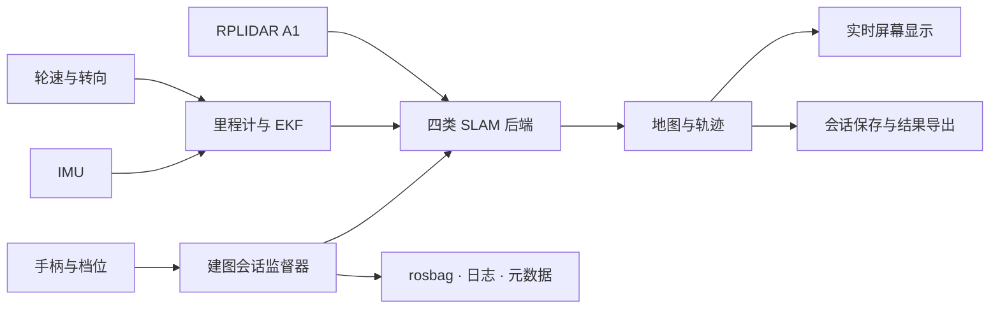

# ROSMASTER R2 · LiDAR SLAM Lab

### 阿克曼移动机器人的多算法建图与系统实现

从机器人接入到实车建图，把遥控、传感器、算法切换与实验记录连接起来。

**[机器人设置](Gamepad_and_Car_Setup.md) · [问题与修复](R2_Issues_and_Fixes.md) · [研发日志](logs/) · [运行代码](patches/)**

**A real-robot testbed for LiDAR SLAM, system integration and mapping experiments.**

---

## 项目概览

本项目在 **ROSMASTER R2 阿克曼底盘、Raspberry Pi 5 与 RPLIDAR A1** 上集成四类激光 SLAM，实现手柄驱动的建图启停、算法切换、实时地图显示和会话化记录。

研究重点包括：让传感器与里程计链路正常工作，区分算法估计问题与系统显示问题，并为后续可重复的算法对照保留数据。

| 平台 | 建图环境 | 算法 | 交互与记录 |
|---|---|---|---|
| ROSMASTER R2 · Raspberry Pi 5 | ROS2 Foxy · Docker · RPLIDAR A1 | GMapping / Cartographer / SLAM Toolbox / RTAB-Map 2D | USB 手柄 · 档位与 LED · 实时地图 · rosbag |

## 结果展示

### 实车建图

### 点云展示

以上沿用原 README 中已经公开的展示图。各次图像对应的采集条件与数据来源需要分别说明，不能仅根据视觉效果做算法精度排名。RGB-D / 视觉 SLAM 仍为后续研究方向。

## 系统架构

| 实现部分 | 内容 | 代码入口 |
|---|---|---|
| 底盘与传感器 | 阿克曼里程计、IMU/EKF、启动健康检查 | [里程计](patches/rosmaster_odom.py) · [EKF](patches/ekf_r2.yaml) · [健康检查](patches/robot_healthcheck.py) |
| 多算法建图 | 同一控制入口选择后端，按算法与档位管理会话 | [SLAM 监督器](patches/slam_supervisor.py) |
| 遥控与状态 | 手柄、档位、算法颜色和状态灯 | [手柄补丁](patches/yahboom_joy_R2_patched.py) · [驱动补丁](patches/Ackman_driver_R2_patched.py) |
| 结果展示 | 地图自适应缩放、状态和轨迹显示 | [地图显示](patches/map_kiosk.py) |
| 部署与启动 | Docker、节点启动、串口占用管理和 systemd | [启动脚本](patches/ros2_bringup.sh) · [服务配置](systemd/rosmaster-ros2.service) |

## 四类激光 SLAM

| 算法 | 输入与实现路径 | 参数入口 |
|---|---|---|
| GMapping | LiDAR + EKF 里程计，粒子滤波建图 | [配置](patches/slam_gmapping.yaml) |
| Cartographer | LiDAR + 里程计/IMU，子图与位姿图 | [配置](patches/rosmaster_carto.lua) |
| SLAM Toolbox | LiDAR + 里程计，异步位姿图 | [配置](patches/slam_toolbox_r2.yaml) |
| RTAB-Map 2D | 激光 ICP + EKF 里程计，保存图与数据库 | [配置](patches/rtabmap_r2.yaml) |

原部署记录覆盖四类后端的启动、地图生成和会话保存。不同阶段的验证工况不完全相同；正式比较需固定路线、速度、参数和成功标准。

## 项目中的关键问题与处理

| 问题 | 实现中的处理 | 公开记录 |
|---|---|---|
| 手柄晚于系统启动，控制链路未接入 | 等待设备、热插拔后恢复手柄节点 | [手柄与档位日志](logs/2026-07-15_红灯指示与档位调整.md) |
| 建图启停、雷达和显示状态分散 | 引入常驻监督器，统一会话生命周期 | [联动建图日志](logs/2026-07-15b_档位联动建图与屏幕实时显示.md) |
| Cartographer 地图显示“没有墙” | 从仅接受占用值 100 改为阈值渲染 | [Cartographer 排查日志](logs/2026-07-17_cartographer与问题排查.md) |
| 原始里程计异常影响建图 | 增加里程计样本检查、EKF 与启动健康检查 | [里程计代码](patches/rosmaster_odom.py) · [问题记录](R2_Issues_and_Fixes.md) |
| 地图超出屏幕、轨迹与优化状态不同步 | 地图适配屏幕，并接入优化图/路径显示 | [地图显示](patches/map_kiosk.py) · [监督器](patches/slam_supervisor.py) |

研发日志保留了当时的现场观察和调参判断。对其中关于特定场景适用性的结论，需要结合原始数据和受控重复实验进一步核验。

## 开发与实验进展

| 阶段 | 工作内容 |
|---|---|
| 平台接入 | 从早期 ROS1 使用与问题排查，推进到 ROS2 Foxy 容器环境 |
| 2026-07-15 | 手柄、档位、LED 提示和建图/显示联动 |
| 2026-07-17 | Cartographer 接入、地图渲染诊断与离线重建管线 |
| 多算法扩展 | 加入 SLAM Toolbox 与 RTAB-Map 2D，完善记录与运行监测 |
| 后续研究 | 统一条件的算法对照、速度影响和 RGB-D 融合 |

## 机器人操作

1. 系统启动后，通过 Back 启用普通控制。
2. 左摇杆控制行驶，右摇杆控制转向；LB 切换速度档位。
3. Y 选择下一次建图的算法：蓝 / 黄 / 绿 / 紫分别对应四类后端。
4. 1、2 档用于建图；结束控制、进入高档或竞速状态时保存并停止建图。

详细设置见[手柄与小车配置](Gamepad_and_Car_Setup.md)。会话目录为 `/root/rosmaster_maps/YYYYmmdd_HHMMSS_algorithm_gearN/`，按版本与后端保存地图、轨迹、档位事件、日志、元数据和 rosbag。

## 下一阶段

- [ ] 汇总逐次实验及对应的地图、轨迹和日志证据。
- [ ] 使用同一份 rosbag 做算法和参数的配对回放。
- [ ] 固定路线与速度开展重复实车实验。
- [ ] 引入参考轨迹或测量地标，评估定位和地图误差。
- [ ] 采集同步 RGB-D 数据，验证融合方案。

## 文档与源码导航

| 材料 | 入口 |
|---|---|
| 手柄与平台设置 | [Gamepad_and_Car_Setup.md](Gamepad_and_Car_Setup.md) |
| 问题与修复 | [R2_Issues_and_Fixes.md](R2_Issues_and_Fixes.md) |
| ROS1 → ROS2 迁移 | [ROS_问题总结与迁移指南.md](ROS_问题总结与迁移指南.md) |
| 按日期的研发过程 | [logs/](logs/) |
| 机器人端运行实现 | [patches/](patches/) |
| 自启动与数据同步 | [systemd/](systemd/) · [sync_scan.sh](sync_scan.sh) |

---

**ROSMASTER R2 · Raspberry Pi 5 · RPLIDAR A1 · ROS2 Foxy**

展示页整理：2026-11-18

