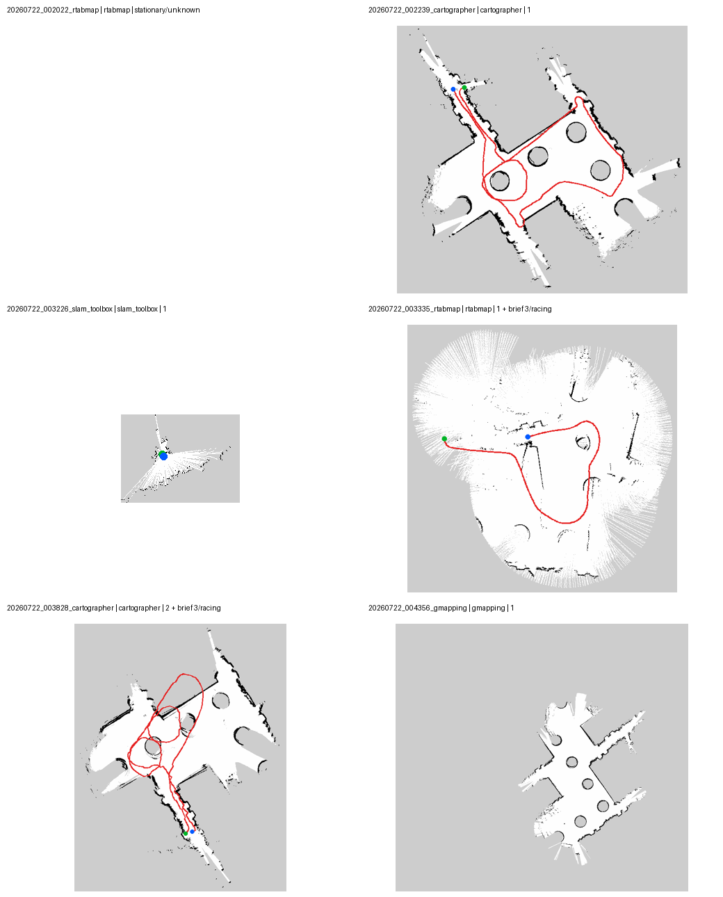

# 实验盘点与证据结论

盘点日期：2026-11-17。范围：当前本地工作区中的代码、归档、日志、轨迹和 SQLite 数据；未连接机器人，也未核对远程仓库。最新原始实验会话为 2026-07-23，文件修改时间不能替代实验发生时间。

线上运行补丁位于 `patches/`；`research/` 收录后续辅助代码快照。本次展示整理未向机器人部署代码。

## 1. 数据总览

| 数据组 | 数量 | 性质 | 汇报用途 |
|---|---:|---|---|
| 早期 ROS1 地图导出 | 5 份 | 压缩备份内的 PGM/YAML/PCD 产物 | 说明建图与导出链路已产生输出 |
| 2026-07-22 ROS2 会话 | 6 个 | 启动失败、行驶建图和故障诊断 | 展示多算法运行情况及具体问题 |
| 2026-07-23 修复验证 | 3 个 | 静止状态功能验证 | 展示修复后的短时运行与输出能力 |
| RGB-D 融合 | 0 个可核对会话 | 有参数和控制代码，无对应原始采集 | 作为扩展设计和下一阶段实验 |
| 最新参数离线对照 | 0 组结果 | 有回放脚本、基线快照，无回放指标产物 | 作为后续实验方法 |

9 个 ROS2 会话中有 8 个非空 bag，数据库时间跨度累计 2019.828 秒，约 33.7 分钟，包含 14,882 条 `/scan` 消息。这里统计的是采集时段和收到的激光消息，包含后端异常期间的数据，不等于 SLAM 成功运行时长。

详细统计见[审计 JSON](../reports/experiment_audit_20261117.json)和[会话总表](../reports/session_summary_20261117.csv)。

## 2. 2026-07-22：初始实车记录

日期相同的会话用开始时刻区分。路径长度和首尾距离均从 `trajectory.csv` 计算，为系统自身估计；没有外部参考轨迹。

| 开始时刻 | 算法 | Bag 时长 | 激光帧数 | 轨迹点数 | 轨迹长度 / 首尾距离 | 审计判断 |
|---|---|---:|---:|---:|---|---|
| 00:20:22 | RTAB-Map 2D | 0.0 s | 0 | 0 | 无数据 | 传感器健康检查中止，未产生地图 |
| 00:22:39 | Cartographer | 559.1 s | 4,071 | 1,005 | 86.07 m / 1.317 m | 有地图、轨迹及约束修正记录 |
| 00:32:26 | SLAM Toolbox | 57.6 s | 420 | 3 | 0.145 m / 0.145 m | 后端发生 probability-search 致命异常；不能算成功完成 |
| 00:33:35 | RTAB-Map 2D | 264.0 s | 1,942 | 444 | 37.60 m / 8.964 m | 有地图；存在 629 条 negative-Hessian-index 告警，缺少成功闭环证据 |
| 00:38:28 | Cartographer | 291.6 s | 2,150 | 491 | 82.82 m / 0.902 m | 有地图与修正记录，旧显示轨迹未随全局优化重写 |
| 00:43:56 | GMapping | 624.4 s | 4,607 | 0 | 缺失 | 有 1120×1024 地图；轨迹为空，结束元数据不完整 |

当时尚未记录独立的档位事件，档位依据 `/cmd_vel` 的持续速度上限推断。Cartographer 两次会话分别主要对应 0.17 m/s 和 0.33 m/s 的命令；后一次与 RTAB-Map 行驶记录都含短时高速命令。因此不能把它们当作严格控制变量的速度对照。

### 数据标签需要纠正的解释

1. **`complete` 不保证后端健康。** SLAM Toolbox 的元数据写有 `status: complete`，但 [nodes.log](../scan_archives/20260722_latest/20260722_003226_slam_toolbox/nodes.log) 明确包含 `Mapper FATAL ERROR - unable to get pointer in probability search!`。报告按日志将该会话归为故障记录。
2. **旧 `loop_events=1` 不是一次成功闭环。** [原分析脚本](../scan_archives/analyze_latest_scans.py)按关键词计数，RTAB-Map 匹配到的是“没有图像订阅，词袋闭环检测将被禁用”的提示。行驶会话数据库中 Link.type 仅出现 0，共 620 条；不能据此报告成功闭环。原始 CSV 保留原状，新审计把相关日志文本单独列出。
3. **GMapping 数据可读，但会话记录不完整。** `metadata.txt` 含 157 个 NUL 字节，bag 的 `metadata.yaml` 为空。SQLite 仍包含 131,285 条消息且 `quick_check` 返回 `ok`。现有回放脚本直接读取 SQLite，不依赖空 YAML；标准 rosbag 播放前仍需在副本上修复或重建元数据。
4. **首尾距离不是轨迹精度。** 1.317 m 和 0.902 m 表示所记录轨迹起终点的几何距离；未确认严格回到同一物理位姿，也没有外部真值，不能称为 ATE、RPE 或算法精度排名。
5. **历史轨迹与最终地图并非完全同步。** 旧 Cartographer 的 CSV 是在线采样轨迹，不能直接作为最终优化后的轨迹。对照图中的红线主要用于诊断。

### 地图与原始证据

各子图来自不同路线、时长和档位，不构成地图精度的公平对照。SLAM Toolbox 子图只是崩溃前留下的局部输出。

## 3. 2026-07-23：修复后的静止验证

| 会话 | Bag 时长 | 激光帧数 | 可验证的输出 | 证据边界 |
|---|---:|---:|---|---|
| [RTAB-Map gear1](../scan_archives/20260723_validation/20260723_230953_rtabmap_gear1/metadata.txt) | 94.3 s | 705 | 地图、数据库、bag；日志中 negative-Hessian-index 告警为 0 | 静止测试；没有行驶闭环证据 |
| [Cartographer gear2](../scan_archives/20260723_validation/20260723_231330_cartographer_gear2/metadata.txt) | 55.5 s | 426 | 地图、优化轨迹、图边；`trajectory_source=cartographer_pose_graph` | gear2 是档位标签，测试期间速度命令为 0 |
| [SLAM Toolbox gear1](../scan_archives/20260723_validation/20260723_231526_slam_toolbox_gear1/metadata.txt) | 73.4 s | 561 | 地图、bag；未复现此前的 probability-search 致命异常 | 仅证明这一段静止运行，仍需长距离行驶验证 |

Cartographer 的原始 CSV 有 2 个点，首尾相距约 0.080 m；优化轨迹有 147 个点，首尾相距约 0.0014 m。两者是不同来源、采样密度的轨迹，且测试静止，不能据此计算行驶精度提升比例。

这些验证支持“修复后可启动、持续接收数据并导出结果”的阶段结论，不支持“二档闭环精度得到提升”或“轮胎打滑问题已解决”。

## 4. 早期 ROS1 工作

备份 `rosmaster_export_current_full.tar.gz` 中有 5 份 800×800 地图及对应 YAML、PCD：

| 导出名 | PCD 点数 | 可说明的内容 |
|---|---:|---|
| `my_map` | 98 | 早期地图保存与占据栅格转点云链路 |
| `slam_map_20260615_164725` | 205 | 定时地图快照 |
| `slam_map_20260615_164745` | 205 | 另一份定时地图快照 |
| `outdoor_map_20260616_045543` | 118 | 文件名标记为 outdoor 的历史导出 |
| `outdoor_map_20260616_051314` | 101 | 另一份文件名标记为 outdoor 的导出 |

这些地图约有 98.4%–99.9% 的像素为未知区域，展示了有限覆盖的早期产物。`outdoor` 是文件命名，缺少路线、参考测量和完整会话信息，不能作为室内外性能对照。两个定时快照的 PGM 是否完全相同可查审计中的 SHA-256；导出份数不等于独立实验次数。

PCD 从二维占据地图提取障碍栅格，`z=0`，不能作为原生三维重建结果。

## 5. 代码已具备、数据尚未证明的内容

- [RGB-D 融合配置](../research/rtabmap_rgbd_r2.yaml)和控制入口已经存在，但 9 个 bag 均未发现有数据的 camera/image/rgbd 话题，也无对应融合会话。
- [结束流程模块](../research/slam_finalization.py)记录服务响应、图文件和结果。历史会话均没有 `finalization.json`，因此不能把当前代码能力追溯为历史实验证明。
- 当前监督器包含配置快照逻辑，历史会话均无 `configuration/sha256.json`。不能用当前参数文件冒充当时的精确配置。
- [回放工具](../research/optimization/replay_slam.py)存在，但本地没有 `metrics.json` 等完整回放结果，不能报告参数优化收益。
- 本地 `scan_fix_work/optimization/baseline/` 是文件快照；Cartographer 配置与当前版本相同，其他文件包含部分差异。它没有对应的历史提交或实验配对，不能据此命名“修复前原版”。

## 6. 建议采用的报告结论

> 本项目在 ROSMASTER R2 平台上搭建了多算法 SLAM 实验框架，保留了激光建图会话及相应地图、日志和轨迹，定位了后端异常、优化器告警及记录完整性问题。修复后的静止测试验证了部分运行和导出功能。当前数据主要支撑系统实现、问题诊断和阶段性功能验证；算法精度、速度影响与 RGB-D 融合收益需通过受控重复实验进一步评估。

## 7. 核对方法

本次直接以只读方式查询 9 个 rosbag SQLite 数据库，逐库 `PRAGMA quick_check` 均返回 `ok`；核对话题消息数、时间跨度、轨迹 CSV、RTAB-Map 数据库和备份中的地图产物。SQLite 完整性检查通过仅说明数据库结构可读，不证明传感器同步或 SLAM 质量。

现有结束流程的 4 项单元测试通过。核对工具、数据缺失行为和环境要求见[复查与复现说明](REPRODUCIBILITY.md)。

## 8. 线上研发日志的补充证据

线上还保留了 [7 月 15 日的手柄与档位记录](../logs/2026-07-15_红灯指示与档位调整.md)、[档位联动与地图显示记录](../logs/2026-07-15b_档位联动建图与屏幕实时显示.md)和 [7 月 17 日的 Cartographer 排查与重建记录](../logs/2026-07-17_cartographer与问题排查.md)。这些日志包含低压、架空空转、地图渲染阈值和历史离线重建的现场记录。对应原始采集文件未纳入这 9 个会话，故作为研发过程引用，不并入本次数据总量或受控性能比较。其中“只适合某场景”“户外首选”等旧判断来自当时有限试验，正式报告采用本次审计说明的证据范围。
